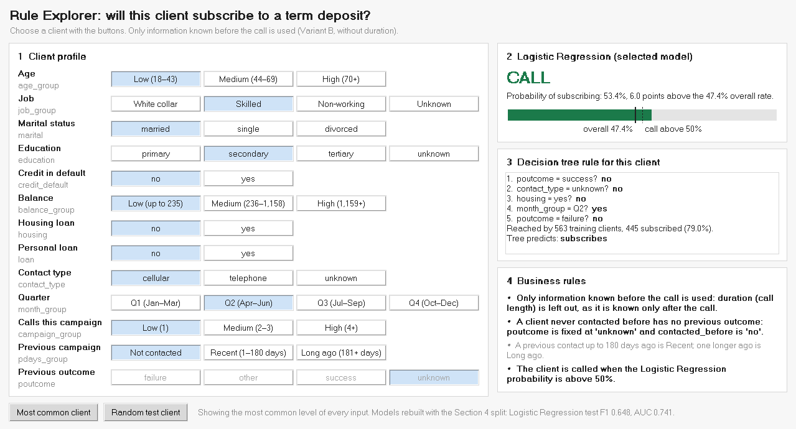

# 5024CMD Data Science Portfolio — Bank Marketing

Predicts whether a bank client will subscribe to a term deposit
(`deposit` = yes/no) **before the client is contacted**, using a SQLite
database and a four-stage Python pipeline.

## Data

`data/bank.csv` holds 11,162 records of 17 attributes (16 inputs and the
target): 5,289 subscribers (47.4%) and 5,873 non-subscribers (52.6%). The
file was provided by the module lecturer. Its size and attribute names match
the Bank Marketing Dataset published on Kaggle by J. M. Bachmann, an extract
of the Bank Marketing data in the UCI Machine Learning Repository
(Moro, Rita, & Cortez, 2014, https://doi.org/10.24432/C5K306).

## Setup

Tested with Python 3.13. Install the exact package versions used for the
report:

```
pip install -r requirements.txt
```

Figure 2.1 also needs [Graphviz](https://graphviz.org/) (`dot` on the PATH).
The Rule Explorer needs Tkinter, which comes with the python.org installers
for Windows and macOS; on Linux, install the `python3-tk` package.

## Run order

Run from this folder. Each stage reads what the previous one wrote.

```
python Init_Database.py
python Data_Preprocessing.py
python Exploratory_Analysis.py
python Predictive_Model.py
dot -Tpng -Gdpi=150 data_model_erd.dot -o output/figures/fig_data_model_erd.png
```

Stage 1 rebuilds the database from scratch, which also removes the
`CleanedData` table, so always run stage 2 after stage 1. Stages 3 and 4
depend on stages 1 and 2 but not on each other. Every random process uses a
fixed seed, so repeated runs give identical logs.

## Rule Explorer

```
python Rule_Explorer.py            # writes the log, opens the window
python Rule_Explorer.py --check    # writes the log only
```

A small window for trying the model on one client at a time, run after
stages 1 and 2. Each input of the deployable model (Variant B, without
duration) has a row of buttons. Choosing a client shows the Logistic
Regression probability of subscribing against the 47.4% overall rate, the
decision tree rule the client falls under with its training counts, and the
business rules that apply. A client who was never contacted before has the
previous outcome fixed at `unknown`, as in the data.

The models are rebuilt with the same inputs, split, seed and settings as
`Predictive_Model.py`, so they match Section 4 of the report. Every run
writes `output/rule_explorer_report.txt`, which repeats Logistic
Regression's test F1 of 0.648 and AUC of 0.741 and the tree's root split of
749 training clients, 682 of whom subscribed, and records the three example
clients discussed in Section 4.7 (Figure 4.6 is the opening view). "Random
test client" loads a client from the 30% test set and shows whether they
actually subscribed.



## Files

| File | Stage | Reads | Writes |
|---|---|---|---|
| `Init_Database.py` | 1 | `data/bank.csv` | `data/bank_marketing.db` (four tables and the `AnalysisSet` view), `output/init_database_report.txt` |
| `Data_Preprocessing.py` | 2 | `AnalysisSet` | `CleanedData` table, `output/data_preprocessing_report.txt` |
| `Exploratory_Analysis.py` | 3 | `CleanedData` | Figures 1.1 and 3.1–3.6, `output/exploratory_analysis_report.txt` |
| `Predictive_Model.py` | 4 | `CleanedData` | Figures 4.1–4.5, `output/predictive_model_report.txt` |
| `Rule_Explorer.py` | – | `CleanedData` | `output/rule_explorer_report.txt`, then opens a window |
| `data_model_erd.dot` | – | – | Source for Figure 2.1 |

The database is not committed, because stage 1 rebuilds it. The logs and
figures in `output/` are committed so that a rerun can be compared against
them.

## Figure numbering in the report

| Caption | File |
|---|---|
| Figure 1.1 | `fig01_target_distribution.png` |
| Figure 2.1 | `fig_data_model_erd.png` |
| Figure 3.1 | `fig02_numeric_distributions.png` |
| Figure 3.2 | `fig03_boxplots.png` |
| Figure 3.3 | `fig05_scatterplots.png` |
| Figure 3.4 | `fig04_correlation_heatmap.png` |
| Figure 3.5 | `fig06_categorical_rates.png` |
| Figure 3.6 | `fig07_numeric_by_class.png` |
| Figure 4.1 | `fig08_model_comparison.png` |
| Figure 4.2 | `fig09_roc_curves.png` |
| Figure 4.3 | `fig13_lr_odds_ratios.png` |
| Figure 4.4 | `fig12_decision_tree.png` |
| Figure 4.5 | `fig10_confusion_matrices.png` |
| Figure 4.6 | `docs/rule_explorer.png` (screenshot of the Rule Explorer) |

`fig11_feature_importance.png` is still produced by stage 4 but is not used
in the report.

## References

Bachmann, J. M. (n.d.). *Bank marketing dataset* [Data set]. Kaggle.
https://www.kaggle.com/datasets/janiobachmann/bank-marketing-dataset

Moro, S., Cortez, P., & Rita, P. (2014). A data-driven approach to predict
the success of bank telemarketing. *Decision Support Systems, 62*, 22–31.
https://doi.org/10.1016/j.dss.2014.03.001

Moro, S., Rita, P., & Cortez, P. (2014). *Bank marketing* [Data set]. UCI
Machine Learning Repository. https://doi.org/10.24432/C5K306
